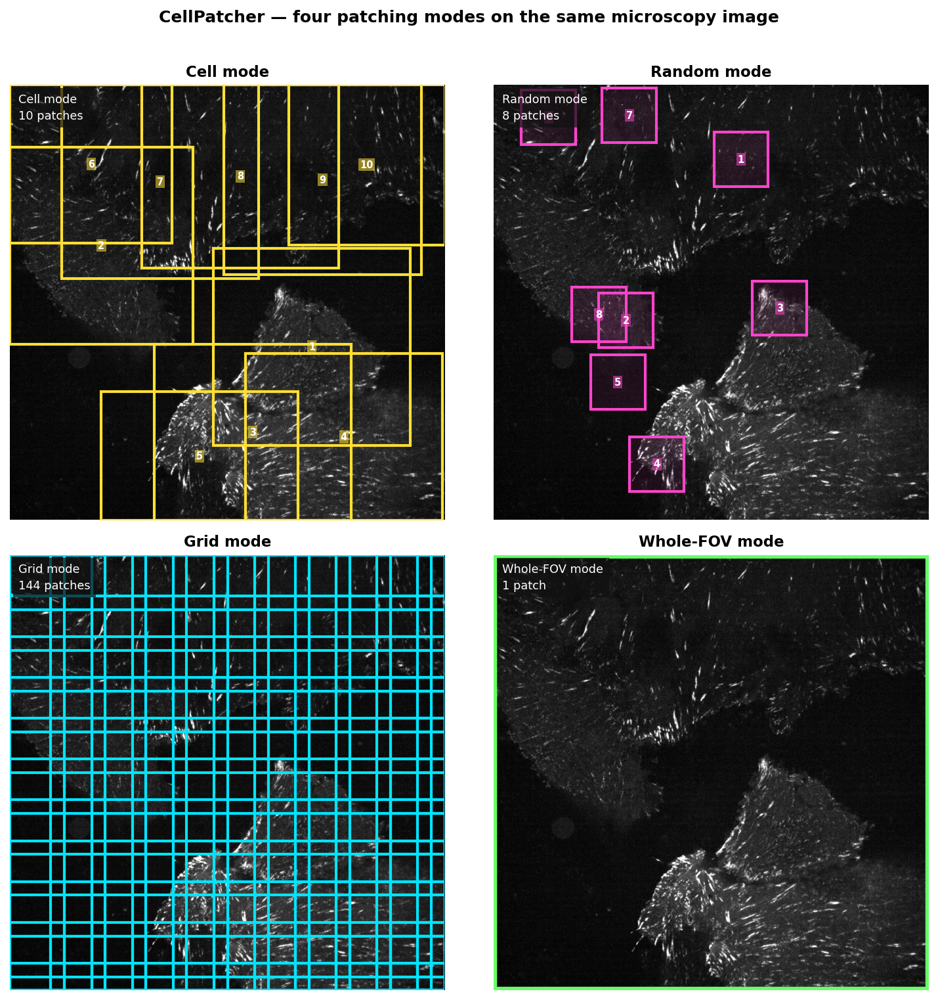

# CellPatcher

CellPatcher helps you turn microscopy images into reproducible patch datasets without wrestling with custom one-off scripts. It generates patch coordinates (and, if you want, extracted arrays) using segmentation-based cell patches, random patches, grid tiles, and whole-field patches. You can drive everything from interactive notebooks or the Python API.

## Start here

Since v0.2.0 CellPatcher reads image and mask files only through a run of the
[MorphoBricks preprocessing brick](https://github.com/CellMigrationLab/morphobricks-preprocessing)
(v0.5): describe the experiment and publish its description in the preprocessing notebook, run it
on your experiment first, then point CellPatcher to the run's output folder. A run without a
published description is refused (`A_DESCRIPTION_REQUIRED`). What changed, with the migration notes for the
other bricks, is in the [CHANGELOG](notebooks/CellPatcher/CHANGELOG.md) (v0.2.0rc1 to v0.4.0).

- **Normal user / manual workflow:** open `notebooks/CellPatcher/CellPatcher.ipynb` and give it the preprocessing run's output folder.
- **Choosing a patching strategy:** open `notebooks/CellPatcher_Strategy_Examples/CellPatcher_Strategy_Examples.ipynb`: each strategy on one image of your preprocessing run, nothing written.
- **Training or feature extraction in PyTorch:** open `notebooks/CellPatcher_Pytorch/CellPatcher_Pytorch.ipynb`: the patches of an export as a batch of tensors.
- **API copy-paste examples:** read `docs/api_examples.md`.
- **Multidimensional C/Z/T data:** read `docs/preprocessing.md`.
- **Normalizing intensities** with the MorphoBricks preprocessing statistics: read `docs/normalization.md`.

- Reads every image and mask of a folder or tree run through the preprocessing run (`RunInputs`): its images, their FOV keys, the axis roles and the image/mask pairing it recorded, so every brick reads the same files the same way. Files the run did not record are refused, never left out.
- Generates patch regions (`PatchRegion`) for `cell`, `random`, `grid`, and `whole_fov` modes.
- Optionally filters regions, extracts arrays, resizes outputs, and exports patch files.
- Optionally clears pixels outside the selected segmented object in cell mode (`apply_mask=True`).
- Writes patch metadata (CSV) alongside exported patch files when enabled. Every patch has a run-independent
  `patch_id` built from its position, object set, planes and label or rectangle, and a `position_id`
  (see "Patch identity" in `docs/configuration_reference.md`). In-memory images given to `run_patching` need
  `image_metadata=[{"position_id": ...}]` (or an `image_file`); unnamed images are refused.
- Cell-mode masks are object sets: an `instances` mask is used as given; a `binary` mask (as the run's
  description declares it, or a boolean array in memory) is refused unless the request sets the explicit
  `CellConfig.binary_mask_policy="connected_components"` (no default), which labels it with the one shared
  labeller, `cellpatcher.label_objects(mask, policy, connectivity)`. A file run asks its preprocessing
  run's resolver for the mask by its description ID (`matching.mask_id`).
- Reads TIFF and OME-Zarr images (those the preprocessing run accepted), patches time series plane by plane (Z-stacks must be projected in preprocessing first), and optionally normalizes
  patches with the MorphoBricks preprocessing statistics (`config.normalization`, see `docs/normalization.md`).

## Patching modes at a glance



| Mode | Use it when... | Needs masks? | Typical output |
|---|---|---|---|
| `cell` | You have segmentation labels and want one patch per object/cell. | Yes | One patch per labeled object/cell |
| `random` | You want random fixed-size sampling for controls or coverage checks. | Optional | Random fixed-size patches |
| `grid` | You want deterministic tiling over the image. | No | Regular tiles (with optional overlap/partials) |
| `whole_fov` | You want one patch representing the entire field of view. | No | One patch covering the full image |

**Options shared with the MorphoBricks bricks (issue #33).**
- `random.seed_scope` chooses which planes share rectangles:
  - `"plane_channel"` is the default and today's behaviour: the seed includes the `t`, `z` and `c` the image's metadata gives (channels split with `split_channels` share their region's rectangles either way);
  - `"plane"`: the seed leaves out `c`, so channels given as separate images get the same rectangles;
  - `"position"`: every plane of a position gets the same rectangles.
- `random.min_mask_fraction` is the least share of a draw's pixels that must lie in the sampling mask. Left unset (the default), any overlap is accepted. An explicit `0` means the mask excludes nothing: the rectangles are those of a run without it (since 0.2.0, matrix finding F8).
- `whole_fov.square_cover=True` adds the squares covering the FOV for square-input models: mode `whole_fov_square`, id `<parent>/sq<N>`, with `parent_id`.

Every region also records:
- `requested_y0/y1/x0/x1`, the rectangle before clipping to the image;
- `patch_touches_image_border`, and `object_touches_image_border` for cell patches;
- with `run_patching(..., fraction_masks=[{name: mask}, ...])`, its share inside each named mask (`mask_fractions`, written as `mask_fraction_<name>` columns). Cell patches always carry `own_object`.

## Workflow at a glance

```text
images/masks → CellPatcherConfig → run_patching → PatchRegion metadata + patch arrays and/or exported files
```

All four modes use the same orchestration function: `run_patching`. The notebooks build `CellPatcherConfig` for you and call the same backend API.

## Quick start: notebooks

- **Recommended:** `notebooks/CellPatcher/CellPatcher.ipynb` (app-style workflow and preferred manual testing path). Its four steps: the preprocessing run (and, only if the experiment was moved, where it is now), the settings, a preview of one image, and the export. It runs in JupyterLab and in Google Colab, where its first cell mounts Google Drive and installs CellPatcher's release tag.
- **Strategy examples:** `notebooks/CellPatcher_Strategy_Examples/CellPatcher_Strategy_Examples.ipynb` previews the cell, grid, random and whole-FOV strategies on one image of the same preprocessing run (the main notebook's preview, nothing written).
- **PyTorch:** `notebooks/CellPatcher_Pytorch/CellPatcher_Pytorch.ipynb` loads an export of the main notebook with `ExportedPatchTorchDataset` and shows the first batch (needs the `torch` extra; Colab has PyTorch).

All three notebooks share the same first cell (LabConstrictor portability: JupyterLab and Colab, Google Drive on Colab, the install pinned to the release tag).

Open the notebook in Colab:

[](https://colab.research.google.com/github/CellMigrationLab/CellPatcher/blob/main/notebooks/CellPatcher/CellPatcher.ipynb)

## Common user-facing APIs vs advanced helpers

**Common user-facing APIs**
- `CellPatcherConfig` and config dataclasses
- `run_patching` and `run_patching_pipeline`
- `read_array` and `validate_image_and_mask_folders`
- `scan_cell_patch_size`
- `prepare_image_for_patching` and `iter_image_planes_for_patching`

**Advanced helpers**
- low-level strategy classes
- axis utilities
- extract/resize/export helper functions
- other lower-level utility APIs

## Quick start: Python API

- Start here: [Quick start](docs/quick_start.md)
- More usage patterns: [API examples](docs/api_examples.md)
- Full options and fields: [Configuration reference](docs/configuration_reference.md)

## Installation / local development

**Local / JupyterLab:**

- From the repository root, install the package: `python -m pip install -e .`
- Add extras as needed:
  - tests: `python -m pip install -e .[test]` (with Ruff and the notebook-runner packages; add `notebook` for the notebook's tests)
  - notebooks: `python -m pip install -e .[notebook]`
  - optional Torch adapter: `python -m pip install -e .[torch]`
  - OME-Zarr images: `python -m pip install -e .[zarr]` (the MorphoBricks preprocessing and
    normalization bricks, used for discovery, pairing and normalization, are core dependencies)
- `requirements.txt` remains a pinned notebook/tooling environment snapshot.
- Before a pull request: `python tools/check.py` (pytest, Ruff and the MorphoBricks code rules
  against their shrink-only baseline, `tools/code_rules_baseline.json`); `--rules` runs only the
  code rules and Ruff.

**A release, anywhere (Google Colab included):**

```bash
pip install "cellpatcher[notebook,zarr] @ git+https://github.com/CellMigrationLab/CellPatcher.git@v0.4.0"
```

The notebook's first cell does this on Colab (pinned to its `RELEASE_TAG`), mounts Google Drive and
enables the widgets; keep the preprocessing run, the experiment and the output folder on Drive.

## Optional preprocessing for multidimensional data

Patching modes are 2D Y/X; for C/Z/T data, see `docs/preprocessing.md`. Folder and tree runs split T with
`config.common.t_policy` (`"all"`, `"first"`, `"select"`). Z=1 passes; Z>1 is refused under every `z_policy`
(project or select first with `convert --project` in morphobricks-preprocessing).

Note: plane iterator `metadata` (the `t`/`z` indices) reaches `PatchRegion` rows and the export CSV when passed through as `run_patching(..., image_metadata=...)`; the `plane_id` string itself is not mirrored onto `PatchRegion` and still needs an explicit join if you need it. See `docs/preprocessing.md`.

## Limitations / non-goals

- CellPatcher does **not** segment cells; you must provide masks/labels for cell mode.
- CellPatcher does **not** run DINO/Torch inference in the core package.
- Users must provide valid images and, for cell mode, masks/labels.

## More documentation

- [Documentation map](docs/README.md)
- [Quick start](docs/quick_start.md)
- [Patching mode guide](docs/patching_modes.md)
- [API examples](docs/api_examples.md)
- [Preprocessing guide](docs/preprocessing.md)
- [Normalization guide](docs/normalization.md)
- [Configuration reference](docs/configuration_reference.md)
- [Developer notes](docs/developer_notes.md)
- [Notebook guide](notebooks/README.md)
- [Fixture guide](tests/fixtures/readme.md)


- Optional Torch dataset adapter is available via `cellpatcher.torch_dataset`; Torch remains optional and DINO inference is not included in core (see `docs/api_examples.md`).

## 🔄 Automatic Template Updates

LabConstrictor can prepare pull requests that keep this repository aligned with improvements in the main template, including updates to GitHub Actions workflows. Complete the one-time [automatic synchronization setup](.tools/docs/template_synchronization.md) to enable these updates.
