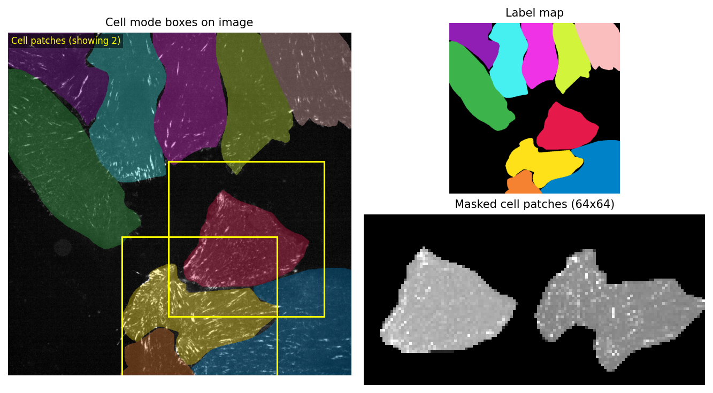
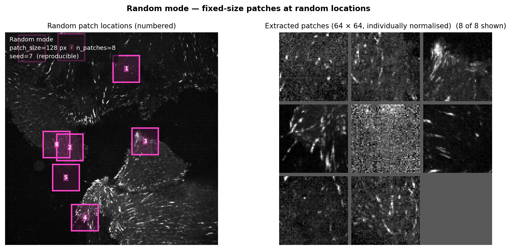
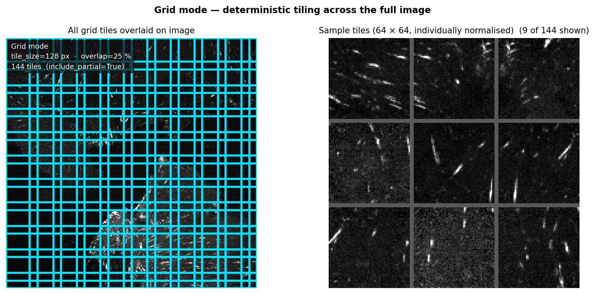
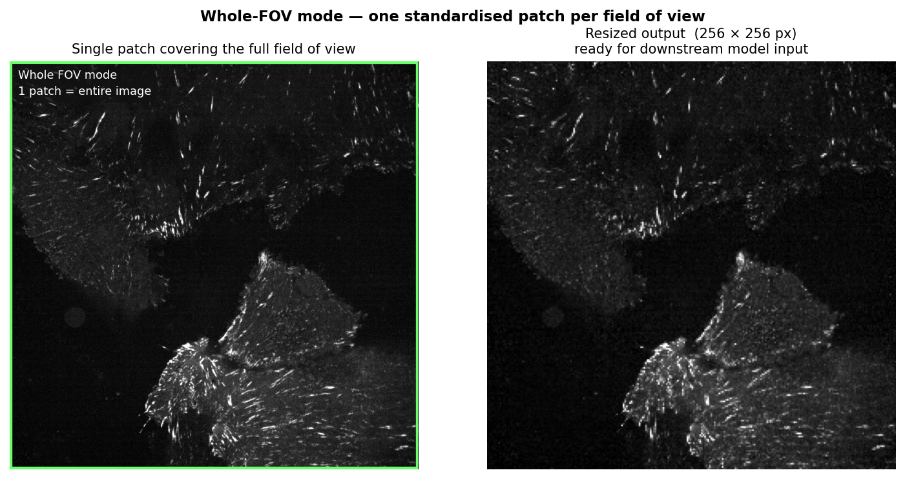
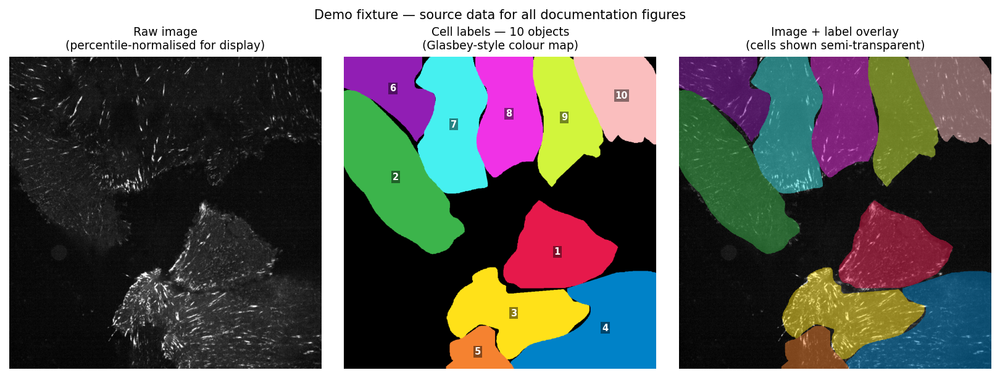

# Patching modes

> See also: [Docs map](README.md) · [Quick start](quick_start.md) · [Patching modes](patching_modes.md) · [API examples](api_examples.md) · [Preprocessing](preprocessing.md) · [Config reference](configuration_reference.md)

## Choosing a mode

| Mode | Use when | Needs masks? | Typical output |
|---|---|---|---|
| `cell` | You want one patch per segmented object/cell. | Yes | One patch per object/cell |
| `random` | You want fixed-size random controls or randomized coverage. | Optional | Fixed-size random patches |
| `grid` | You want deterministic image tiling. | No | Regular image tiles |
| `whole_fov` | You want one patch for each full field of view. | No | One patch covering the full image |

The overview figure uses the bundled real TIFF fixture so you can compare every mode side by side.

## Important: patching modes generate 2D Y/X regions

`cell`, `random`, `grid`, and `whole_fov` all define how **2D `Y/X` regions** are generated.
If you want every Z slice or T frame, expand stacks first with:

- `iter_image_planes_for_patching`
- `iter_cell_planes_for_patching`

Treat this as explicit plane-by-plane preprocessing, **not** true volumetric 3D patching. See `preprocessing.md`.

## Cell mode

Cell mode creates one patch per segmented object/cell. Masks are **instance labels**: each non-zero
integer value is one object, used as given (a 0/1 or 0/255 integer mask is one object). A **boolean** mask has
no object ids and is refused, unless `binary_mask_policy="connected_components"` explicitly opts in to labelling
its connected components (with a warning). Labels above the int32 maximum are refused.

Key parameters to know:

- `patch_size`
- `exclude_border`
- `center_on`
- `min_area` / `max_area`
- `binary_mask_policy`
- `apply_mask` (in `ExtractionConfig`)
- `mask_fill_value` (fill value used when `apply_mask=True`)
- `mask_channel` (required for multi-channel label arrays in memory; mask files with a channel axis are refused: save one mask type per file, e.g. `<image>_cells.tif` and `<image>_nuclei.tif`)
- labels must resolve to one 2D `YX` plane (use preprocessing helpers for C/Z/T labels)

Notes:

- `patch_size="auto"` is per-object adaptive sizing.
- `scan_cell_patch_size(...)` gives dataset-level recommendations for a fixed patch size.
- `recommended_size("max")` returns the largest included bounding-box square size across the dataset — closest to legacy fixed-size behavior.
- `recommended_size("p95")` returns the 95th-percentile square size — often a practical compromise for model workflows.
- Other scan summaries are also available for tuning: `recommended_size("median")`, `recommended_size("mean")`, and `recommended_size("p90")`.
- `apply_mask=True` clears pixels outside the selected label before resize/export.

Common pitfalls:

- Wrong `image_axes` / `mask_axes`.
- Passing a boolean mask: convert it to integer labels, or opt in to `binary_mask_policy="connected_components"` (whose computed labels are not the mask's values).
- Picking a global patch size without scanning first.
- Expecting border-touching objects when `exclude_border=True` (default): it skips objects whose *bounding boxes* touch the image border, not patches.

### Cell mode figure

## Random mode

Random mode creates fixed-size random patches, with optional seeded reproducibility. With a seed, each image (plane) is
sampled from a seed derived from `random.seed` and its `position_id`/`t`/`z`/`c`, so its rectangles do not depend on
which other files are in the run.

- Optional `masks` can restrict sampling to allowed regions.
- Sampling is **with replacement**, so duplicate regions are possible.

Key parameters:

- `patch_size`
- `n_patches`
- `seed`
- optional sampling mask (`masks=...`)

Common pitfalls:

- Very sparse masks can make valid sampling difficult.
- If the sampling mask is too sparse (or all `False`), random mode can fail after too many attempts to find valid patches.
- No `seed` means non-deterministic outputs.
- Duplicate patches are valid behavior.

For C/Z/T data, patching modes are 2D Y/X; see `preprocessing.md`.

### Random mode figure

## Grid mode

Grid mode performs deterministic tiling across each image.

Key parameters:

- `tile_size`
- `overlap`
- `include_partial`
- `partial_mode` (`"flush"` default, or `"clipped"`)

Common pitfalls:

- `overlap` changes stride (higher overlap → more patches).
- `include_partial` controls edge coverage.
- With `include_partial=True`, the default `partial_mode="flush"` adds a full tile flush with the
  far edge next to the clipped edge tiles, so edge tiles overlap. `partial_mode="clipped"` keeps
  only the clipped edge tiles: with `overlap=0` the tiles cover every pixel exactly once.
- Large images and small tiles can produce many patches quickly.

For C/Z/T data, patching modes are 2D Y/X; see `preprocessing.md`.

### Grid mode figure

## Whole-FOV mode

Whole-FOV mode returns one region covering the entire image.

Great for:

- full-image export
- downstream workflows expecting one standardized resized image per field

You can still apply extraction/resizing/export settings.

Common pitfalls:

- Expecting multiple patches.
- Forgetting `output_size` when a fixed model input size is required.

For C/Z/T data, patching modes are 2D Y/X; see `preprocessing.md`.

### Whole-FOV figure

## Fixture visual context

These docs figures are derived from the same demo fixture image and labels:

## Filtering, extraction, resizing, and export

Mode chooses **where** patches come from. The rest of the pipeline controls **what happens next**:

- `FilterConfig`: remove candidate regions by intensity/foreground criteria.
- `ExtractionConfig`: extract arrays, set `output_size`, set `pad_mode`, optionally `apply_mask` in cell mode.
- `ExportConfig`: write patch files (`image_format`) and optional metadata CSV.

Typical flow: generate regions → filter → extract → apply mask (cell mode only) → resize → export + metadata.

Note: iterator `metadata`/`plane_id` values are not automatically injected into `PatchRegion` fields or export CSV metadata.

## Practical recommendations

- For cell-centered model patches: scan first, choose `p95` or `max`, then resize.
- For exploratory QC: start with `whole_fov` or `grid`.
- For random controls: use `random` with an explicit `seed`.
- For DINO-like downstream modeling: use fixed-size resized outputs; inference itself is **not** part of CellPatcher core.

## Multidimensional stacks (Z/T) and preprocessing

Patching modes are 2D Y/X; for C/Z/T data, see `preprocessing.md`.

Use `prepare_image_for_patching(...)` / `prepare_labels_for_cell_patching(...)` for single-plane prep, or `iter_image_planes_for_patching(...)` / `iter_cell_planes_for_patching(...)` to iterate all planes. This is explicit preprocessing (not true volumetric 3D patching).
